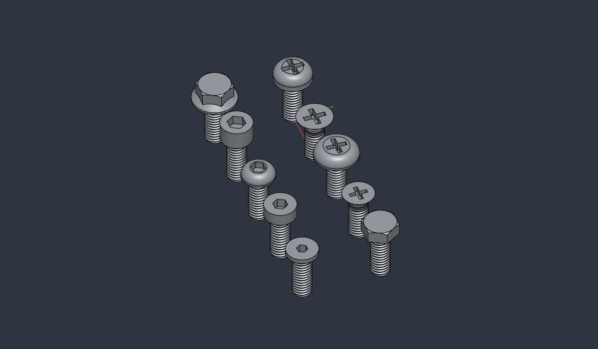
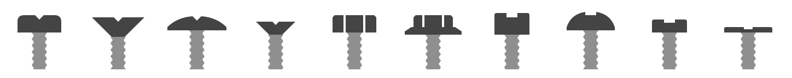

# JISボルト・小ねじ（SolidCraft プラグイン）

[SolidCraft](https://github.com/tangency-labs/solidcraft) のモデルタブから、頭の種類・サイズ・長さを選ぶだけで、ねじ山つきのボルトや小ねじを作れるプラグインです。寸法は JIS（一部はメーカー寸法）の表から取っています。



## 使い方

1. [Releases](../../releases) から `jis-hex-bolt.zip` をダウンロードします。
2. SolidCraft の **環境設定 → プラグイン → プラグインをインストール…** で zip を選びます。権限の確認が出たら承認します。
3. モデルタブの **プラグイン** グループのボタンから **JISボルト・小ねじ…** を選びます。
4. 頭の種類・サイズ・長さ・ねじ を選んで **実行** します。ボルトは原点に、ねじ先を下にして作られます。

| 項目 | 内容 |
|---|---|
| 頭の種類 | ナベ・皿・トラス・小形皿・六角・フランジ付き・六角穴付き・ボタン・低頭・極低頭 |
| サイズ | M3〜M20（頭の種類ごとに選べる範囲が違います。範囲外はメッセージを出して何も作りません） |
| 長さ | 1〜300 mm。皿と小形皿は頭を含めた全長、ほかは頭の下からの長さ |
| ねじ | 規格どおり（六角・フランジ付きは長いと半ねじ、ほかは全ねじ）／全ねじ |



## 寸法の出どころ

| 頭の種類 | 規格・出典 | サイズ |
|---|---|---|
| ナベ | JIS B 1111（ISO 7045） | M3〜M10 |
| 皿 | JIS B 1111（ISO 7046-1） | M3〜M10 |
| トラス | JIS B 1111 附属書JA | M3〜M8 |
| 小形皿 | メーカー寸法 | M3〜M8 |
| 六角 | JIS B 1180（ISO 4014） | M3〜M20 |
| フランジ付き | JIS B 1189 附属書JA 2種 | M5〜M16 |
| 六角穴付き | JIS B 1176（ISO 4762） | M3〜M20 |
| ボタン | ISO 7380-1 | M3〜M16 |
| 低頭 | メーカー寸法（DIN 7984 相当） | M3〜M20 |
| 極低頭 | メーカー寸法 | M3〜M10 |

表の値は `src/spec.js` にまとめてあります。規格の原本ではなく、公開されている寸法表から写した値です。

### 簡略化しているところ

- **十字穴**：幅と深さを合わせた簡略な形で、JIS B 1012 の十字穴の形そのものではありません。
- **丸み**：ナベの角の丸み、トラスとボタンのドームの丸みは見た目で決めています（頭の直径と高さは表どおり）。
- **フランジ**：つばの上は単純な円すいです。
- **ナベの M3・M5**：資料によって寸法が少し違います。今は頭の直径 5.6 mm（M3）、9.5 mm（M5）にしています。
- **六角の L > 200 mm のねじ部長さ**（2d+25）は、まだ資料で確かめていません。

### 制限

- 作ったあとにダイアログでサイズを変えることはできません（ふつうの形状として残ります）。
- プレビューが出ないことがあります（原因調査中）。

## 自分でビルドする

Node.js と PowerShell 7 が必要です。

```powershell
npm install
pwsh ./build.ps1
```

テスト → `src` を1ファイルにまとめる → `bolt.wasm` を作る → アイコンを作る → `jis-hex-bolt.zip` を作る、の順に進みます。`npm test` で寸法表のテストだけ走らせられます。

`template/` には、同じ六角ボルトをプラグインなしで使えるパラメトリックなひな形（`.sc`、日本語版・英語版）が入っています。

## ライセンス

MIT（[LICENSE](LICENSE)）。`wit/plugin.wit` は SolidCraft のリポジトリから取ったもので、Apache License 2.0 です。

---

**English**: A SolidCraft plugin that builds JIS bolts and machine screws (10 head types, M3–M20) with modelled threads from a dialog in the Model tab. Download the zip from Releases and install it via Preferences → Plugins → Install plugin…. Dimensions are in `src/spec.js`.
